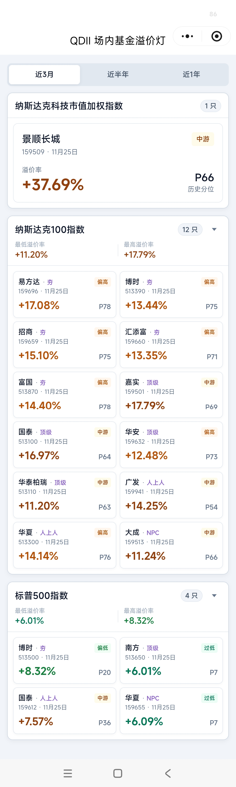
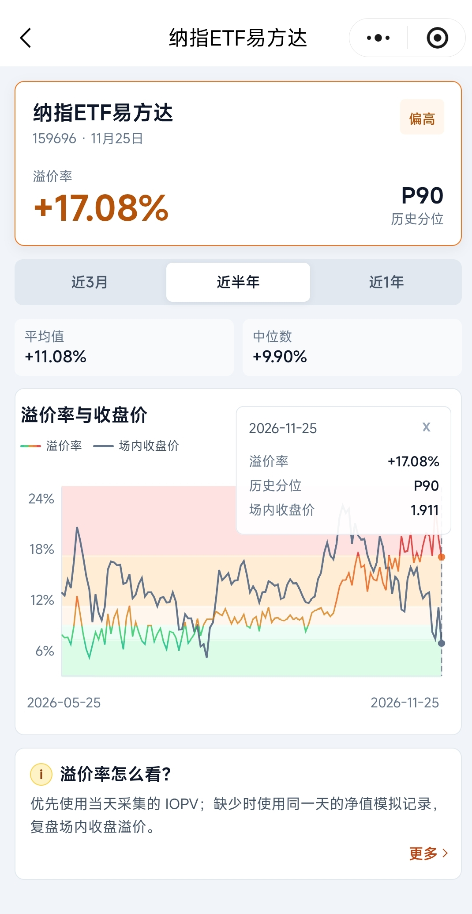

# QDII 场内基金溢价灯

用历史分位判断 QDII 场内 ETF 当前的溢价率处于高位还是低位。

QDII 基金受外汇额度限制，申购常被暂停，场内价格容易高于基金净值，高出的部分就是溢价。本项目每天记录 17 只纳斯达克 100、纳指科技和标普 500 场内 ETF 的溢价率，并把当前值放到近 3 月、近半年、近 1 年的历史中比较。微信小程序名为「灯下记录」。

<table>
  <tr>
    <th>首页</th>
    <th>详情页</th>
  </tr>
  <tr>
    <td valign="top"></td>
    <td valign="top"></td>
  </tr>
</table>

## 功能

- **首页**：按跟踪指数分组，展示每只基金的最新溢价率、历史分位和溢价状态
- **详情页**：溢价率与场内收盘价走势，以及区间平均值和中位数
- **观察区间**：近 3 月、近半年、近 1 年
- **自动更新**：每个交易日收盘后采集 IOPV，刷新首页数据

## 计算方法

```text
溢价率 = 场内收盘价 / 参考净值 - 1
```

参考净值优先使用收盘后采集的 IOPV，即交易时段发布的基金份额参考净值。当天没有 IOPV 时，用开盘前最近一个美股交易日的基金单位净值近似；两者都没有的交易日不参与计算。

历史分位是所选区间内溢价率不高于当前值的交易日占比，据此分为五档：

| 状态 | 历史分位 |
| --- | --- |
| 过低 | P10 以下 |
| 偏低 | P10（含）至 P30 |
| 中游 | P30（含）至 P70 |
| 偏高 | P70（含）至 P90 |
| 过高 | P90 及以上 |

## 项目结构

```text
backend/                Azure Functions（Python），数据存于 Azure Table Storage
├── function_app.py     HTTP API 与收盘后定时采集
├── cli.py              数据导入与维护命令
└── shared/             基金配置、存储、IOPV 采集、Excel 导入、首页快照
frontend/               uni-app + Vue 3 + TypeScript，构建为微信小程序与 H5
├── src/pages/          首页与详情页
└── src/config/         首页排序与评级
```

跟踪的基金清单在 [`backend/shared/config.py`](backend/shared/config.py)。

## 快速开始

### 前置条件

- Python 3.10+ 和 [Azure Functions Core Tools](https://learn.microsoft.com/azure/azure-functions/functions-run-local) v4
- Node.js 18+
- Azure Storage 账号；本地运行定时任务还需要 [Azurite](https://learn.microsoft.com/azure/storage/common/storage-use-azurite)

### 后端

```bash
cd backend
python -m venv .venv
source .venv/bin/activate        # Windows: .venv\Scripts\activate
pip install -r requirements.txt
```

在 `backend/` 下新建 `local.settings.json`（已被 git 忽略）：

```json
{
  "IsEncrypted": false,
  "Values": {
    "FUNCTIONS_WORKER_RUNTIME": "python",
    "AzureWebJobsStorage": "UseDevelopmentStorage=true",
    "AZURE_STORAGE_CONNECTION_STRING": "<Azure Storage 连接字符串>"
  }
}
```

然后运行 `func start`。

### 前端

```bash
cd frontend
npm install
cp .env.example .env.local       # 填写 VITE_API_BASE_URL
npm run dev:h5                   # 浏览器预览
npm run dev:mp-weixin            # 用微信开发者工具打开 dist/dev/mp-weixin
```

没有后端时，把 `VITE_USE_MOCK` 设为 `true`，前端会使用仓库内置的示例数据。

## 配置

| 变量 | 位置 | 说明 |
| --- | --- | --- |
| `AZURE_STORAGE_CONNECTION_STRING` | 后端 | Azure Table Storage 连接字符串 |
| `VITE_API_BASE_URL` | 前端 | 后端 API 地址 |
| `VITE_USE_MOCK` | 前端 | 为 `true` 时使用内置示例数据 |
| `VITE_DISABLE_CACHE` | 前端 | 为 `false` 时启用一小时本地缓存；未设置时不缓存 |

## 数据维护

历史数据先由 Excel 工作簿导入，之后每个交易日收盘后由定时任务自动追加 IOPV。在 `backend/` 下运行：

```bash
python cli.py import-excel --file <workbook.xlsx> --all --dry-run   # 只校验，不写入
python cli.py import-excel --file <workbook.xlsx> --all             # 导入
python cli.py verify-excel --file <workbook.xlsx>                   # 核对已导入的数据
python cli.py dashboard                                             # 重建首页快照
python cli.py collect-iopv --dry-run                                # 手动采集 IOPV，不写入
```

工作簿格式以 [`shared/excel_import.py`](backend/shared/excel_import.py) 的校验规则为准，全部命令见 `python cli.py --help`。

## API

| 接口 | 说明 |
| --- | --- |
| `GET /api/dashboard` | 首页数据，包含各观察区间的分位和状态 |
| `GET /api/etfs` | 基金列表及最新溢价率 |
| `GET /api/etfs/history?code=159696&start=2026-01-01&end=2026-06-30` | 单只基金的溢价历史，`start`、`end` 可省略 |

`premium_rate` 为小数，例如 `0.1708` 表示 17.08%。

## 测试与部署

- 后端测试：在 `backend/` 下运行 `python -m unittest discover -s tests`
- 前端测试：在 `frontend/` 下运行 `npm test` 和 `npm run type-check`
- 部署后端：`func azure functionapp publish <函数应用名>`
- 发布小程序：运行 `npm run build:mp-weixin`，用微信开发者工具打开 `frontend/dist/build/mp-weixin` 上传

## 免责声明

数据来自公开行情与基金公告，可能存在延迟或误差。首页评级仅代表作者个人观点。本项目仅供学习研究，不构成投资建议。
